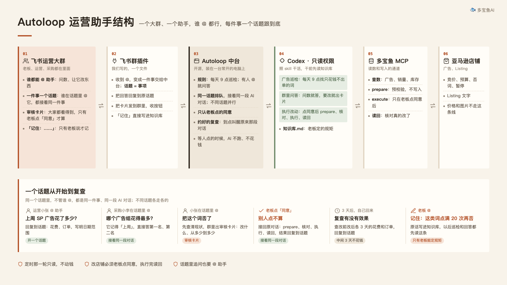

# autoloop-feishu-group

给 [Agent Autoloop](https://github.com/KKKKhazix/agent-autoloop) 用的飞书群插件，加一套亚马逊运营的 skill。装好以后：

- **一个大群、一个助手**：群里谁都可以 @ 它问数、让它改东西。
- **一件事一个话题**：不管谁在话题里 @ 它，都接着同一段 AI 对话，它记得前面查过什么。
- **审核卡片发到群里**：大家都看得到，只有老板点「同意」才算。点完它接着干：prepare、核对、执行、读回，结果回复到话题。
- **改完自己回来复查**：执行后约好 3 天，到点回到原来的话题，报告改动有没有效果。
- **「记住：……」**：老板说的话写进知识库，以后干活前先读。
- **每天 9 点巡检**：只读查只花钱不出单的广告词，有问题就出审核卡片。



## 需要先有

- 装好 Agent Autoloop（v1.8 以上），`agent-autoloop try` 显示「试跑通过」。
- 一个已登录的命令行 Agent（下面以 Codex 为例），并且连上了多宝鱼 MCP（读亚马逊数据、prepare 和 execute 都走它）。
- 飞书 CLI（`npm i -g @larksuite/cli`），用你自己的飞书账号登录过。

## 安装

**1. 装插件**

```bash
agent-autoloop add https://github.com/bibibivera/autoloop-feishu-group
```

插件装在 `~/.agent-autoloop/plugins/autoloop-feishu-group/`。

**2. 建项目文件夹**，把 skill 和知识库复制过去（Agent 在这里干活）：

```bash
mkdir -p ~/Desktop/运营助手
cp -R ~/.agent-autoloop/plugins/autoloop-feishu-group/skills ~/.agent-autoloop/plugins/autoloop-feishu-group/知识库.md ~/Desktop/运营助手/
```

**3. 建飞书机器人**

1. `lark-cli config init --new`，浏览器里用飞书扫码，建一个应用。
2. 在飞书开发者后台：打开「机器人」能力；在「事件与回调」里用长连接订阅「接收消息」（`im.message.receive_v1`）和「卡片回传交互」（`card.action.trigger`）；发布版本。
3. 把机器人拉进运营群（群设置 → 群机器人 → 添加），记下群号（`oc_` 开头）。
4. 你自己的 open_id：`lark-cli auth status` 里的 `openId`。

一个飞书应用只能在一台电脑上收消息和按钮。已经接了 Autoloop 内置 `feishu` 通道的，换成这个插件时要把内置那个删掉。

**4. 两把密钥**

```bash
agent-autoloop key new channel group
agent-autoloop key new source feishu-group
```

**5. 改配置**

`~/.agent-autoloop/config.json` 的 `channels` 里加（完整示例见 [examples/config.json](examples/config.json)）：

```json
"group": {
  "use": "autoloop-feishu-group",
  "key": "第 4 步 channel 那把密钥",
  "chat": "oc_运营群的群号",
  "user": "ou_你自己的 open_id",
  "hub": "config.json 顶上 url 那个地址",
  "sourceKey": "第 4 步 source 那把密钥",
  "memory": "/绝对路径/运营助手/知识库.md"
}
```

`~/.agent-autoloop/rules.json` 里加来源、通道和两条规则（完整示例见 [examples/rules.json](examples/rules.json)）。Codex 的权限设成只读：

```json
"sources":  { "feishu-group": { "name": "飞书群" } },
"agents":   { "codex": { "name": "Codex", "worker": "this-machine", "use": "codex", "access": "read" } },
"channels": { "group": { "name": "飞书群", "answerers": ["ou_你自己的 open_id"] } },
"defaultChannels": ["group"]
```

**6. 检查和重启**

```bash
agent-autoloop check
agent-autoloop service install
agent-autoloop doctor
```

`doctor` 里看到「飞书群在线」就好了。试一下：`agent-autoloop run 广告巡检`，群里会出一张审核卡片；或者在群里 @ 机器人问「上周 SP 广告花了多少」。

## 用的时候要知道

| | |
|---|---|
| 话题里追问 | 也要 @ 机器人。飞书默认只把 @ 机器人的消息给它；想不 @ 也能收，得给应用申请「获取群组中所有消息」，这是敏感权限，要企业管理员批 |
| 谁能问 | 群里所有人。只想让几个人能问，config 里加 `"askers": ["ou_xx", "ou_yy"]` |
| 谁能批 | 只有 rules.json 里 `answerers` 写的人，别人点卡片不算 |
| 谁能定规矩 | 只有 config 里 `user` 那个人说「记住：……」才写进知识库 |
| 模拟还是正式 | 看 `知识库.md` 里的「执行模式」，默认「模拟」：点同意也只 prepare 和读回，不调用 execute |
| 复查时间 | skill 里写的是 3 天后上午 10 点；演示时可以改成「3 分钟后」 |
| 并发 | 同一个话题一次一轮、排队；不同话题并行（规则里 `parallel`） |
| 电脑关机或睡眠 | 不跑。定时醒来后只补最近一次 |

安全上的几条：

- 定时巡检和群里问答这一轮都是只读权限，Agent 能查数、能 prepare，不能执行。
- 改店铺必须老板点同意；点同意后 Agent 重新 prepare，和卡片一致才执行，执行完读回。
- 群里的原话只当资料，不当命令；Agent 不会因为群里有人说「直接执行」就跳过审核。
- 日预算不超过 $100、竞价不超过 $20、价格和图片不走这条线，写在 skill 和知识库里。

## 文件

| 文件 | 干什么 |
|---|---|
| `channel.ts` | 插件本体：发卡片到群、收按钮、收 @、回复到话题、「记住」写知识库 |
| `skills/广告巡检.md` | 每天 9 点：只读查只花钱不出单的词，出审核卡片；同意后执行、约复查 |
| `skills/群里问答.md` | 有人 @：问数就答；要改店铺出审核卡片；同意后执行、约复查；复查到点回来报告 |
| `skills/执行改动.md` | 点同意之后：prepare → 核对 → execute（模拟不调用）→ 读回 |
| `知识库.md` | 执行模式、规矩、老板让它记住的话 |
| `examples/` | config.json 和 rules.json 示例 |

## 测试情况

2026-11-14 在 macOS、Agent Autoloop v1.8.4、Codex、模拟模式下实测通过：每天 9 点巡检出卡片、群里 @ 问数回复到话题、话题里 @ 追问接着同一段对话、群里让它改东西出卡片、老板点同意后模拟执行和读回、3 分钟后复查回到话题、「记住」写进知识库。

没测过：Windows（插件调用 lark-cli 的方式没在 Windows 真机上跑过）、正式模式的真实写入、Listing 改动的整条线、多人在同一个话题里交替 @。

## 致谢

建立在 [Agent Autoloop](https://github.com/KKKKhazix/agent-autoloop)（MIT，© 2026 数字生命卡兹克）之上，`channel.ts` 参照它内置的飞书通道改写。
